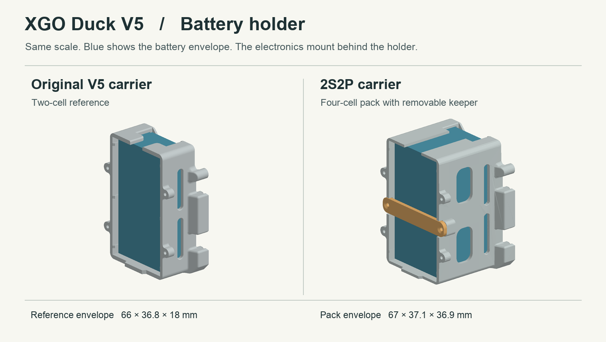

# XGO Duck V5 carrier for a 182 g 2S2P pack

This carrier fits the specified **67 × 37.1 × 36.9 mm** pack envelope using the V5 chassis tabs and PCB mounting features. The PCB and V1.1 electronics cover sit 20.5 mm farther behind the torso. The user weighed the new pack at 182 g. The original pack mass is estimated at 100 g.

- [Editable Fusion assembly](V5_2S2P_assembly.f3d) and [STEP assembly](V5_2S2P_assembly.step)
- [Carrier STL](V5_2S2P_carrier.stl) and [removable keeper STL](V5_2S2P_keeper.stl), in millimeters
- [Printing, mounting hardware and installation](CAD.md)
- [Simulation results and reproduction](simulation/README.md) and [walking replay](battery-walk-comparison.mp4)

The V2 standard donor holder (object 38, “000”) and V5 donor holder (object 50, “BATTERY”) have the same bounding dimensions and material volume to the displayed precision. Comparing 2,500 uniformly sampled surface points in each direction, the largest observed deviation was 0.0032 mm. This supports trying the V5-based part on the current V2 build. Check the physical standoffs, wire slack, enclosure fit and screw length on your board revision before final assembly.

The pack fits digitally through the open chassis side with the keeper removed. Refit the keeper before mounting the carrier. The case and keeper slice to roughly 26.6 g combined under the reference PLA profile, compared with 19.0 g for the stock carrier. The nominal assembled change including the pack and keeper screws is about +90 g. The four-cell wrap, lead bend and connector shape are separate physical fit checks. The repository BOM specifies an XH2.54 connector and a discharge rating above 3C. Confirm the actual connector, polarity and discharge specification before power-up. [Hardware BOM](https://github.com/joshhiggins22/xgoduck_hardware/blob/1bc89265dd9427e44b4cfc664a98079f225d5609/BOM.md)

## Effect on standing and walking

Start hardware comparisons with the **installed Walk policy and the 15 mm feet**. The model predicts about 6.4 mm of rearward shift in the whole robot's upright center of mass. The immediate effect is slower walking and less reserve against a large backward shove. The head and servo dynamics are inherited from the existing training model. A future V5 camera/head installation changes the mass distribution and should be evaluated in its assembled configuration.

The board's existing Walk actor was run at scale 1.0 on matched carpet draws. Eight trials per comparison began upright, held for two seconds, walked at a command of 0.20 m/s for two seconds, and stopped. The backward force was applied after the stop. The physical battery was represented by its measured mass and finite inertia, with the carrier, keeper, board stack, rear electronics cover and IMU repositioned. Ground strikes were screened against the mounted assembly's transformed convex hull. Results below are simulated.

| Heel extension | Median forward speed, original → new | Upright and stopped with new pack | Strong push after walking, original → new |
| --- | --- | --- | --- |
| 5 mm | 0.144 → 0.093 m/s | 8/8 | 3/8 → 1/8 |
| 15 mm | 0.150 → 0.102 m/s | 8/8 | 8/8 → 1/8 |

The strong pulse above was 0.85 N·s/kg, so the heavier build received more force. In a separate comparison with the **same 6.8 N force for 0.1 s**, the new pack recovered in **5/8 on 15 mm** and **0/8 on 5 mm**. In left and right 0.5 rad/s turning trials, every nominal new-pack trial on both heels remained upright and settled after release (8/8 per direction and heel). On 15 mm the two-second commands yielded median turns of +39° and −45°. [Turn episodes](simulation/turns.json)

A full retrain is unnecessary to begin a supported walking trial. For backward tips after stopping, a previously trained recovery Walk is a useful second experiment. With the **182 g pack and 15 mm heels**, it recovered in **7/8 vs 0/8** for the installed Walk on a separate group of matched seeds at 0.85 N·s/kg. On 5 mm, the result was 5/8 vs 0/8. The correction activates at zero movement command. It was designed for backward recovery and should not be expected to restore commanded forward speed. The 0.3.5 controller loaded the candidate on the Mac. Hardware performance with the new pack still needs testing. [Candidate and model notes](https://github.com/joshhiggins22/xgoduck_rl/tree/d14afc89d53480a7e4b8c2984883f151ab253e40/XGO-Duck-Lab/runs/stock-walk-recovery-stress) · [Paired candidate trials](simulation/candidate.json)

For these longer heels, place the duck upright for the first trial. In a separate deep-Sit screen with the installed SitStand model, the enlarged rear assembly reached the simulated floor in 12/12 trials on each heel. Check pack seating and wire slack with power off, then compare short supported forward commands and releases on the same patch of carpet. [Geometry and clearance evidence](validation/SOURCES.md)

The replay shows one preselected seed (16400), with the nominal original and new assemblies on the same 15 mm feet. It includes hold, forward, stop and a moderate 0.35 N·s/kg backward push. The cameras follow each duck. Use the numeric speed and recovery comparisons for performance across trials.

## Source hardware

Mounting geometry comes from the [V5 hardware print set](https://github.com/joshhiggins22/xgoduck_hardware/tree/1bc89265dd9427e44b4cfc664a98079f225d5609/structure/V5_AUDIO_VIDEO_). The reference mounting order appears on page 23 of the [assembly guide](https://github.com/joshhiggins22/xgoduck_hardware/blob/1bc89265dd9427e44b4cfc664a98079f225d5609/Assembly_Guide.pdf). The lab uses the [Mac XGO Duck simulation](https://github.com/joshhiggins22/xgoduck_rl/tree/d14afc89d53480a7e4b8c2984883f151ab253e40/XGO-Duck-Lab). See the hardware fork's [file provenance and licensing notes](https://github.com/joshhiggins22/xgoduck_hardware/blob/1bc89265dd9427e44b4cfc664a98079f225d5609/LICENSING.md).
